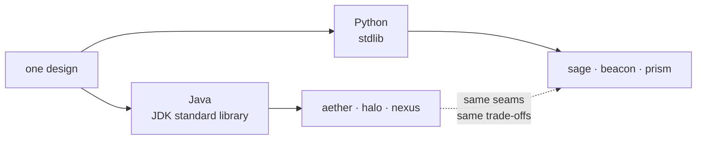

### 喆 · WsNodeX

Backend engineer working on AI tooling. I write zero-dependency libraries in Python
and Java, and Agent Skills that fix what AI writes.

---

**[Quiver](https://github.com/WsNodeX/quiver) — 12 Agent Skills for the job hunt.**

Read a JD, work out what you are missing, drill the interview, fix the résumé,
write the weekly report, defend the internship, negotiate the offer, pick between
them. One chain, twelve skills, installs in one command.

---

**Two skills, one idea: write for the reader, not the author.**

| Project | The failure it fixes |
|---|---|
| [**readme-forge**](https://github.com/WsNodeX/readme-forge) | A README written for its author — launch plans, headline shortlists, diagrams that were never drawn. 13-point audit + rewrite skeleton. |
| [**inheritor**](https://github.com/WsNodeX/inheritor) | Code that withholds what the next reader needs — unnamed literals, TODOs with no exit condition, errors you cannot act on. 8 rules + a checker. |

Both ship a checker rather than advice, and both are held to their own rules:
`readme-forge` audits its own README on every push; `inheritor`'s CI fails if the
checker reports anything against itself.

**Same design, two languages.** Each pair below is one piece of thinking
implemented twice — once on the JDK, once on the Python standard library, with the
same seams and the same trade-offs.

| Problem | Java | Python |
|---|---|---|
| MCP servers | [aether](https://github.com/WsNodeX/aether) | [sage](https://github.com/WsNodeX/sage) |
| Hybrid retrieval + RAG | [halo](https://github.com/WsNodeX/halo) | [beacon](https://github.com/WsNodeX/beacon) |
| LLM resilience (retry · breaker · cache · meter) | [nexus](https://github.com/WsNodeX/nexus) | [prism](https://github.com/WsNodeX/prism) |

Writing it twice is the only way I have found to tell which parts of a design are
essential and which are just the shape of one language's idioms.

---

**Single takes**

- [ember](https://github.com/WsNodeX/ember) — a 1,135-line autograd engine, no NumPy
- [forge](https://github.com/WsNodeX/forge) — byte-level BPE from scratch
- [lumen](https://github.com/WsNodeX/lumen) — vector search with a real HNSW graph
- [cobalt](https://github.com/WsNodeX/cobalt) — seven cache eviction policies, one API
- [slate](https://github.com/WsNodeX/slate) — validation that reports every error at once
- [meter](https://github.com/WsNodeX/meter) — what your LLM calls actually cost
- [neon-protocol](https://github.com/WsNodeX/neon-protocol) — a raycasting FPS in pure Python, no engine, no asset files

---

Most of what I write is an attempt to make a decision survive the person who made
it. A literal with no source, a commit message that repeats the diff, a README that
addresses the author — all the same failure: the reasoning was never written down,
so it has to be rediscovered.

---

[readme-forge](https://github.com/WsNodeX/readme-forge) · [inheritor](https://github.com/WsNodeX/inheritor) · [quiver](https://github.com/WsNodeX/quiver)
