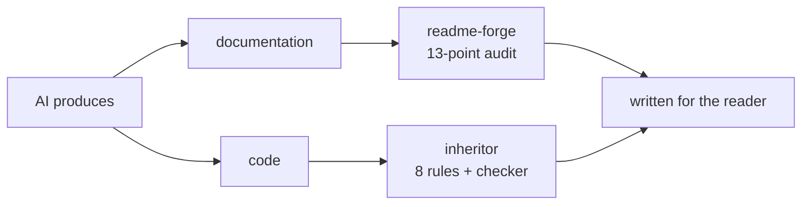

### 喆 · WsNodeX

Backend engineer working on AI tooling. I write zero-dependency libraries in
Python and Java, and Agent Skills that fix what AI writes.

---

**Two skills, one idea: write for the reader, not the author.**

| Project | The failure it fixes |
|---|---|
| [**readme-forge**](https://github.com/WsNodeX/readme-forge) | A README written for its author — launch plans, headline shortlists, architecture diagrams that were never drawn. 13-point audit + rewrite skeleton. |
| [**inheritor**](https://github.com/WsNodeX/inheritor) | Code that withholds what the next reader needs — unnamed literals, TODOs with no exit condition, errors you cannot act on. 8 rules + a checker. |

Both ship a checker rather than advice, and both are held to their own rules:
`readme-forge` audits its own README on every push; `inheritor`'s CI fails if the
checker reports anything against itself.

---

**Libraries** — standard library only, no third-party dependencies

| | |
|---|---|
| **Python** | [ember](https://github.com/WsNodeX/ember) autograd engine · [lumen](https://github.com/WsNodeX/lumen) vector search · [cobalt](https://github.com/WsNodeX/cobalt) cache eviction · [meter](https://github.com/WsNodeX/meter) LLM cost observability · [cairn](https://github.com/WsNodeX/cairn) cron parser · [vellum](https://github.com/WsNodeX/vellum) BM25 knowledge base |
| **Java** | [aether](https://github.com/WsNodeX/aether) MCP server framework · [sluice](https://github.com/WsNodeX/sluice) rate limiting |
| **Playable** | [neon-protocol](https://github.com/WsNodeX/neon-protocol) raycasting FPS in pure Python — no engine, no asset files |

---

Most of what I write is an attempt to make a decision survive the person who made
it. A literal with no source, a commit message that repeats the diff, a README that
addresses the author — all the same failure: the reasoning was never written down,
so it has to be rediscovered.

---

[readme-forge](https://github.com/WsNodeX/readme-forge) · [inheritor](https://github.com/WsNodeX/inheritor) · 中文文档在各仓库 `i18n/` 下
